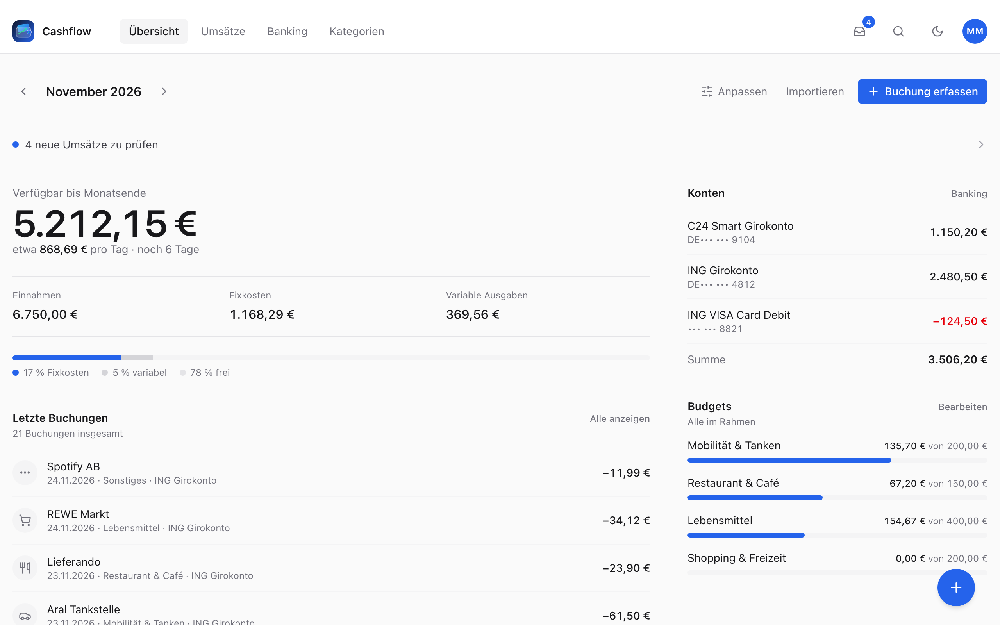
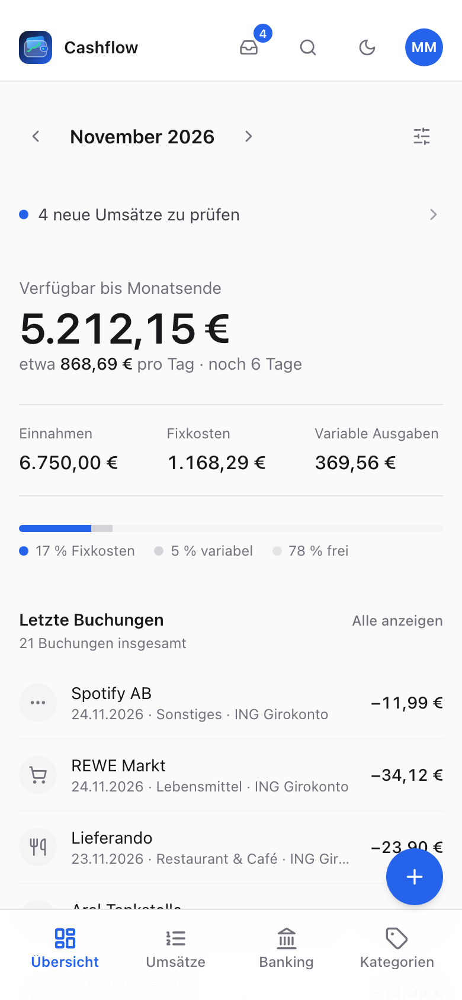
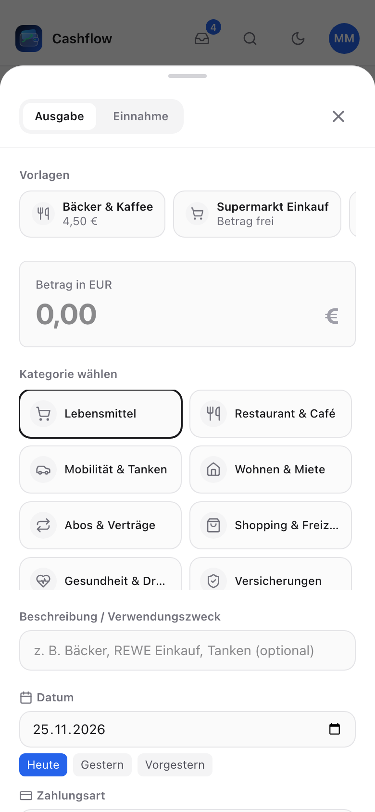
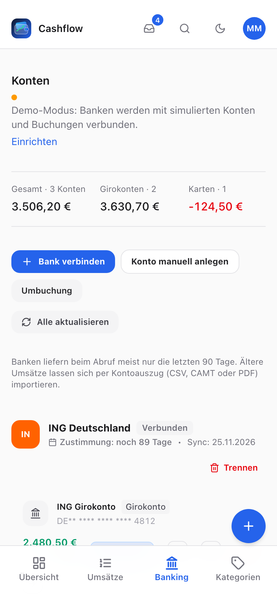
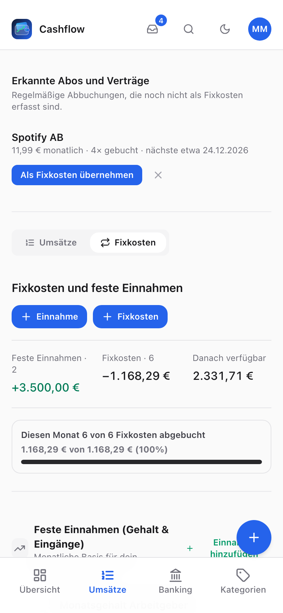
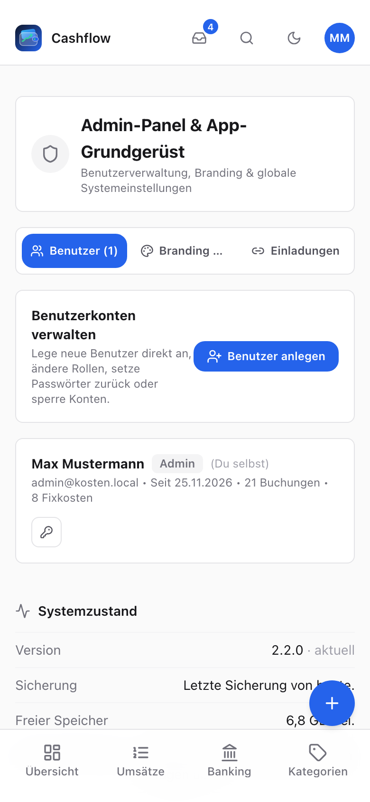

<div align="center">


# Cashflow

Selbst gehostete Web-App (PWA) für Fixkosten, Einnahmen, Ausgaben und Konten.

[](https://github.com/MHabachia/cashflow/actions/workflows/ci.yml)
[](https://github.com/MHabachia/cashflow/releases/tag/v1.1.0)
[](https://github.com/MHabachia/cashflow/pkgs/container/cashflow)
[](LICENSE)

</div>

---

## Funktionen

**Erfassen**
- Schnellerfassung mit Vorlagen, Datum-Schnellwahl und Kontoauswahl; Belegfotos (Kamera oder Upload).
- Split-Buchungen auf mehrere Kategorien, Haupt- und Unterkategorien.
- Offline erfassen (PWA); die Einträge werden bei der nächsten Verbindung übertragen.
- Import von CSV, CAMT.053 und PDF-Kontoauszügen.

**Konten und Banken**
- Bankanbindung über PSD2 (ING, Sparkasse, C24, Commerzbank u. a.), nur lesend.
- Manuelle Konten, Kreditkarten und Bargeld, mit Salden und Umbuchungen.
- Umbuchungen zwischen eigenen Konten werden erkannt und zählen nicht als Ausgabe.
- Umsätze prüfen: neue Buchungen landen zuerst in einer Prüfliste.

**Planung und Auswertung**
- Fixkosten und Einnahmen mit Intervall, Fixkosten-Kalender und Erkennung von Abos.
- Monatsbudgets mit Warnung bei 80 % und 100 %, Sparziele mit Zeitplan.
- Dashboard mit Prognose zum Monatsende, Nettovermögen und Monatsabschluss.
- Jahresbericht und CSV-Export (Buchungen oder Summen je Kategorie).
- Regeln, die Buchungen automatisch kategorisieren.

**Konto und Betrieb**
- Passkeys, Zwei-Faktor-Anmeldung, Passwort-Wiederherstellung ohne E-Mail.
- Registrierung nur per Einladung; Admin-Bereich mit Benutzern, Branding und Sicherheitsprotokoll.
- Automatische, optional verschlüsselte Sicherungen mit Prüffunktion; Systemzustand im Admin-Bereich.
- Push-Benachrichtigungen, Hell- und Dunkelmodus, Suche mit Tastenkürzel (Strg/Cmd + K).

---

## Screenshots

<div align="center">
  
  <br /><br />
  
  <br /><br />
  
  <br /><br />
  
  
  
  <br /><br />
  
  
  
  <br /><br />
  
  
  
</div>

---

## Sicherheit

- **Anmeldung:** Passkeys (WebAuthn) und TOTP-2FA; Passwörter mit scrypt gehasht; Sitzungen über `httpOnly`-Cookies, ohne Cookie-Cache, damit gesperrte Konten sofort draußen sind.
- **Brute-Force-Schutz:** Rate-Limit pro IP in der Datenbank (5 pro Minute für Anmeldung, 2FA und Passwortänderung) und Kontosperre nach 10 Fehlversuchen in 15 Minuten. Die Client-IP kommt aus `IP_ADDRESS_HEADERS` / `TRUSTED_PROXIES`.
- **Registrierung:** Nur der erste Benutzer wird Admin. Danach geht es nur über befristete, einmal einlösbare Einladungen oder direkt durch einen Admin. Der Better-Auth-Endpunkt `/api/auth/sign-up/*` ist gesperrt.
- **Mandantentrennung:** Jede Abfrage und jede Server Action filtert serverseitig auf den angemeldeten Benutzer; Belegfotos werden nur an ihren Besitzer ausgeliefert.
- **Uploads:** Bilder werden per `sharp` geprüft (Magic Bytes, Pixel-Limit), als WebP neu kodiert (entfernt EXIF) und gegen Path-Traversal abgesichert.
- **Eingaben:** Parametrisierte Abfragen über Drizzle, Validierung mit Zod; CSV-Export entschärft Formel-Präfixe (`=`, `+`, `-`, `@`).
- **HTTP:** Content-Security-Policy mit Nonce, HSTS unter HTTPS, `X-Frame-Options: DENY`, `nosniff`, `Referrer-Policy`, `Permissions-Policy`. Redirect-URLs werden nur aus `APP_URL` und `TRUSTED_HOSTS` gebildet.
- **Container:** Start als Root nur zum Korrigieren der Rechte von `/data`, danach unprivilegierter Benutzer (UID 1001).
- **Banking:** Nur lesender Zugriff (AIS), keine Zahlungsauslösung. Bank-Logins laufen ausschließlich bei der Bank. Tokens werden mit AES-256-GCM verschlüsselt (Schlüssel per HKDF aus `TOKEN_ENCRYPTION_KEY`, mit Rotation). Höchstens 4 automatische Abrufe pro Konto und Tag; doppelte Umsätze werden über `(bank_account_id, bank_transaction_id)` verhindert.
- **Protokoll und Sicherungen:** Sicherheitsprotokoll mit 12 Monaten Aufbewahrung; hochgeladene Sicherungen werden geprüft und erst beim Neustart eingespielt; beim Abmelden werden lokale Offline-Daten und Caches entfernt.

---

## Weitere Funktionen im Detail

- **Umsätze prüfen (`/inbox`):** Umsätze aus Bank-Sync und Import landen zur Bestätigung in einer Prüfliste. Kategorie korrigieren, bestätigen und auf Wunsch eine Regel für den Händler anlegen. Am Handy bestätigt Wischen nach rechts, nach links öffnet die Kategorie.
- **Abo-Erkennung:** Auf der Fixkosten-Seite schlägt die App regelmäßige Abbuchungen als Fixkosten vor und meldet Preiserhöhungen.
- **Prognose und Nettovermögen:** Voraussichtlicher Kontostand zum Monatsende (aktueller Stand, minus anstehende Fixkosten, minus durchschnittliche variable Ausgaben der letzten 90 Tage) und täglich gespeicherter Vermögensverlauf.
- **Fixkosten-Kalender:** Fälligkeiten des Monats; die App warnt, wenn der Kontostand dafür rechnerisch nicht reicht.
- **Monatsabschluss:** In den ersten zehn Tagen des Monats zeigt das Dashboard einen Rückblick auf den Vormonat.
- **CAMT.053-Import:** XML-Kontoauszüge (camt.052/053/054) werden beim Import erkannt; das Konto wird über die IBAN zugeordnet.
- **Push-Benachrichtigungen:** Pro Gerät aktivierbar (iOS ab 16.4 nur als installierte App): Budgets, ablaufender Bankzugriff, hohe Abbuchungen, offene Umsätze.
- **Admin-Bereich:** Benutzer, Rollen, Einladungen (1, 7 oder 30 Tage gültig), Branding mit Vorschau und Kontrastprüfung, Systemzustand, Sicherungen (mit „Prüfen"), Sicherheitsprotokoll mit Filter.
- **Update-Hinweis:** Der Admin-Bereich fragt höchstens alle 6 Stunden das neueste GitHub-Release ab. Es werden keine Nutzerdaten gesendet. Abschalten mit `UPDATE_CHECK=false`.

---

## Schnellstart & Deployment per `docker-compose.yml`

Cashflow lässt sich mit dem fertigen Image (`ghcr.io/mhabachia/cashflow:latest`, `linux/amd64` und `linux/arm64`) und einer `docker-compose.yml` starten.

### Option A: Direkt per `docker-compose.yml` deployen (ohne Git-Clone)
Lege auf dem Server (oder in Portainer / Dockge) eine `docker-compose.yml` an:

```yaml
services:
  cashflow:
    image: ghcr.io/mhabachia/cashflow:latest
    container_name: cashflow-app
    restart: unless-stopped
    ports:
      - "3000:3000"
    environment:
      - NODE_ENV=production
      - DATABASE_PATH=/data/app.db
      - UPLOADS_DIR=/data/uploads
      - AUTH_SECRET=bitte-eigenes-32-zeichen-secret-eintragen
      - BETTER_AUTH_SECRET=bitte-eigenes-32-zeichen-secret-eintragen
      - APP_URL=https://cashflow.deinedomain.de
      - BETTER_AUTH_URL=https://cashflow.deinedomain.de
      - NEXT_PUBLIC_APP_URL=https://cashflow.deinedomain.de
    volumes:
      - ./data:/data
    healthcheck:
      test: ["CMD", "wget", "--no-verbose", "--tries=1", "--spider", "http://127.0.0.1:3000/api/health"]
      interval: 30s
      timeout: 5s
      retries: 3
```

Starte den Container mit:
```bash
docker compose up -d
```

### Option B: Aus dem Repository bauen und starten

1. **Umgebungsvariablen anlegen:**
   ```bash
   cp .env.example .env
   ```
   Passe in `.env` mindestens `AUTH_SECRET` (erzeugen mit `openssl rand -base64 32`) und `APP_URL` (dein FQDN) an.

2. **Container bauen und starten:**
   ```bash
   docker compose up -d --build
   ```
   - Die SQLite-Datenbank liegt persistent unter `./data/app.db` (im Container `/data/app.db`).
   - Komprimierte Belegfotos und Profilbilder liegen unter `./data/uploads` (im Container `/data/uploads`).
   - Berechtigungen von `./data` werden beim Containerstart automatisch angepasst.
   - Healthcheck: `http://localhost:3000/api/health`

3. **Ersteinrichtung:**
   - Öffne `http://localhost:3000/register` (bzw. deinen FQDN).
   - Erstelle das erste Konto. Es erhält automatisch Admin-Rechte; die deutschen Standardkategorien und Schnellvorlagen werden angelegt.

---

---

## Bereitstellung über FQDN (Reverse Proxy & Cloudflare Tunnel)

Für die Installation als App, Passkeys und sichere Cookies muss Cashflow über HTTPS unter einem eigenen Domainnamen erreichbar sein.

### 1. Betrieb hinter einem Reverse Proxy
Der Container (Port 3000) läuft hinter einem Reverse Proxy (Nginx, Traefik, Caddy, Nginx Proxy Manager), der TLS terminiert und Anfragen für die Domain an `http://127.0.0.1:3000` weiterleitet.

Hinterlege anschließend deinen FQDN in der `.env`:
```env
APP_URL=https://cashflow.deinedomain.de
BETTER_AUTH_URL=https://cashflow.deinedomain.de
NEXT_PUBLIC_APP_URL=https://cashflow.deinedomain.de
```

### 2. Option: Cloudflare Tunnel (in `docker-compose.yml`)
Wenn keine Ports geöffnet werden sollen, kann die App über einen Cloudflare Tunnel erreichbar gemacht werden:

1. Erstelle im Cloudflare Zero Trust Dashboard unter **Networks → Tunnels** einen neuen Cloudflared-Tunnel und kopiere das **Tunnel-Token**.
2. Ergänze den `cloudflared`-Service in deiner `docker-compose.yml`:
   ```yaml
   services:
     cashflow:
       image: ghcr.io/mhabachia/cashflow:latest
       container_name: cashflow-app
       restart: unless-stopped
       ports:
         - "3000:3000"
       env_file:
         - .env
       volumes:
         - ./data:/data

     cloudflared:
       image: cloudflare/cloudflared:latest
       container_name: cashflow-cloudflared
       restart: unless-stopped
       command: tunnel --no-autoupdate run --token ${CLOUDFLARE_TUNNEL_TOKEN}
       depends_on:
         - cashflow
   ```
3. Hinterlege im Cloudflare Tunnel Dashboard als **Public Hostname** deinen FQDN (z. B. `cashflow.deinedomain.de`) mit dem Ziel `http://cashflow:3000`.
4. Setze in deiner `.env` `APP_URL=https://cashflow.deinedomain.de` sowie `CLOUDFLARE_TUNNEL_TOKEN=...` und starte mit `docker compose up -d`.

---

---

## Bankanbindung (Open Banking / PSD2 & Kreditkarten)

Cashflow kann Bankbuchungen und Kreditkartenumsätze über PSD2 (Enable Banking) abrufen.

### Unterstützte Institute
- **Girokonten & Karten:**
  - **ING Deutschland** (Girokonto, Extra-Konto & VISA Debit Card)
  - **Sparkasse / Finanzgruppe** (Girokonten, Sparkassen-Card & Kreditkarten)
  - **C24 Bank (CHECK24)** (Smart-, Plus- & Max-Girokonto sowie C24 Mastercard)
  - **Commerzbank** (Girokonten, Girocard & Kreditkarten)
  - **Weitere:** DKB, Deutsche Bank, Postbank, Volksbanken & Raiffeisenbanken, N26, Revolut
- **Kreditkarten (Mastercard & VISA):**
  - **TF Bank** (TF Bank Mastercard Gold)
  - **Advanzia Bank** (gebührenfrei Mastercard Gold)
  - **C24 Bank Mastercard**
  - **ING VISA Debit**

### Einrichtung & Ablauf
1. Auf der Seite **Banking (`/banking`)** auf **„Bank verbinden“** klicken.
2. Gewünschte Bank oder Karte aus dem Katalog auswählen.
3. Weiterleitung zur Anmeldeseite der Bank; dort Login und Freigabe (die Zustimmung gilt 90 Tage).
4. Nach erfolgreicher Freigabe leitet die Bank zurück auf Cashflow (`/api/bank-sync/callback`). Die Konten und Karten werden angelegt.
5. Über **„Alle synchronisieren“** oder den Sync-Button am jeweiligen Konto werden neue Umsätze abgerufen, idempotent dedupliziert und automatisch bestehenden Fixkosten-Verträgen (Miete, Strom, Abos) bzw. Kategorien zugeordnet.

### Konfiguration & Umgebungsvariablen

| Variable | Beschreibung | Standard |
|---|---|---|
| `ENABLE_BANKING_APPLICATION_ID` | Anwendungs-ID für Enable Banking (Live-PSD2) | *(Optional)* |
| `ENABLE_BANKING_PRIVATE_KEY` | Privater RSA-Schlüssel (RS256) für die Enable Banking API | *(Optional)* |
| `BANK_SYNC_MOCK` | Simulierter Sandbox-Modus mit Testkonten und -buchungen. In Entwicklung automatisch aktiv, wenn keine Live-Keys hinterlegt sind; **in Produktion nur mit `true`** | `false` |
| `TOKEN_ENCRYPTION_KEY` | Eigener Schlüssel (mind. 32 Zeichen) für die Verschlüsselung der Bank-Tokens. Ohne ihn wird das Auth-Secret verwendet. Bestehende Tokens werden beim nächsten Sync automatisch auf den neuen Schlüssel umgestellt | *(empfohlen)* |
| `TOKEN_ENCRYPTION_KEY_PREVIOUS` | Vorheriger Schlüssel (kommagetrennt) während einer Schlüsselrotation | *(leer)* |
| `CRON_SECRET` | Bearer-Token für `POST /api/cron/bank-sync` (mind. 32 Zeichen); ohne ihn ist der Endpunkt deaktiviert | *(leer)* |
| `BANK_SYNC_INTERVAL_MINUTES` | Intervall des Hintergrund-Syncs | `360` |
| `BANK_SYNC_MAX_UNATTENDED_PER_DAY` | Maximale automatische Abrufe pro Konto und Tag (höchstens 4) | `4` |
| `RATE_LIMIT_ENABLED` | IP-basiertes Rate-Limit für Anmeldung, 2FA und Passwortänderung (in der Datenbank gespeichert). In Produktion standardmäßig aktiv, `false` schaltet es ab | *(auto)* |
| `IP_ADDRESS_HEADERS` | Header, aus denen die Client-IP gelesen wird (kommagetrennt). Hinter Cloudflare z. B. `cf-connecting-ip` | `x-forwarded-for,x-real-ip` |
| `TRUSTED_PROXIES` | IPs/CIDR deines Reverse-Proxys, damit weitergereichte IP-Ketten korrekt ausgewertet werden | *(leer)* |
| `AUTO_BACKUP_ENABLED` | Automatische Datenbank-Sicherungen (`false` schaltet sie ab) | `true` |
| `BACKUP_INTERVAL_HOURS` | Abstand zwischen automatischen Sicherungen | `24` |
| `BACKUP_RETENTION_COUNT` | Anzahl aufbewahrter Sicherungen | `14` |
| `BACKUP_DIR` | Ablageort der Sicherungen | `<Datenbankordner>/backups` |
| `BACKUP_ENCRYPTION_KEY` | Verschlüsselt Sicherungen mit AES-256-GCM (mind. 32 Zeichen). Ohne Schlüssel lassen sie sich nicht wiederherstellen – sicher aufbewahren! | *(leer)* |
| `VAPID_PUBLIC_KEY` / `VAPID_PRIVATE_KEY` | Schlüsselpaar für Push-Benachrichtigungen (base64url). Ohne Angabe erzeugt die App einmalig eines und speichert es in der Datenbank | *(auto)* |
| `VAPID_SUBJECT` | Kontakt für Push-Dienste (`mailto:` oder `https:`); sonst wird `APP_URL` verwendet | *(APP_URL)* |
| `TRUSTED_HOSTS` | Zusätzliche Hostnamen (kommagetrennt, z. B. `kosten.lan:3000`), die neben dem Host aus `APP_URL` für Redirects akzeptiert werden. Andere `Host`-/`X-Forwarded-Host`-Header werden ignoriert | *(leer)* |

> Hinweis zu Reverse Proxy und Cloudflare Tunnel: Die Bank-Autorisierung erfordert, dass die Redirect-URL (`APP_URL + /api/bank-sync/callback`) exakt mit der in deinem Open-Banking-Entwicklerkonto registrierten URL übereinstimmt (z. B. `https://cashflow.deinedomain.de/api/bank-sync/callback`). `APP_URL` muss deshalb in der `.env` auf die richtige HTTPS-Adresse zeigen.

---

---

## Installation als Web-App (PWA) auf Mobilgeräten & Desktop

Die Anwendung lässt sich ohne App-Store aus dem Browser installieren und läuft dann in einem eigenen Fenster:

- **Android (Chrome / Edge / Firefox):** Öffne die Webseite, tippe im Browser-Menü (⋮) auf **„App installieren“** oder **„Zum Startbildschirm hinzufügen“**.
- **iOS / iPadOS (Safari):** Öffne die Webseite, tippe auf das **Teilen-Symbol** und wähle **„Zum Home-Bildschirm“**.
- **Desktop (Chrome / Edge / Safari):** Klicke rechts in der Adressleiste auf das **App-Installations-Icon** bzw. wähle *„Zum Dock hinzufügen“*.

---

---

## Backup & Wiederherstellung von `/data`

Alle Daten (SQLite-Datenbank `app.db` und die Belegfotos, Logos und Profilbilder in `uploads/`) liegen im Ordner `./data`.

```bash
chmod +x scripts/backup.sh
./scripts/backup.sh ./data ./backups
```

Es werden zwei Dateien im Ordner `./backups` erzeugt:
- `app_YYYYMMDD_HHMMSS.db` (konsistenter SQLite-Online-Snapshot)
- `uploads_YYYYMMDD_HHMMSS.tar.gz` (alle Belegfotos & Profilbilder)

**Wiederherstellung über die App (Tools → Backup):** Die hochgeladene `.sqlite`-Datei wird geprüft (Integrität, Schema) und als `app.db.restore-pending` vorgemerkt. Eingespielt wird sie erst beim **nächsten Neustart** der App bzw. des Containers; der bisherige Stand bleibt dabei als `app.db.bak-<Zeitstempel>` erhalten (die letzten 3 werden aufbewahrt).

---

---

## Passwort vergessen (ohne E-Mail-Versand)

Cashflow braucht keinen Mailserver. Es gibt drei Wege zurück ins Konto:

1. **Wiederherstellungscodes (selbst):** Unter *Einstellungen → Wiederherstellungscodes* acht Einmal-Codes erzeugen und sicher aufbewahren. Auf der Anmeldeseite unter *Passwort vergessen?* E-Mail, Code und neues Passwort eingeben.
2. **Link vom Admin:** Im Admin-Bereich beim Benutzer auf das Schlüssel-Symbol → *Link erstellen*. Der Link ist 24 Stunden gültig, nur einmal verwendbar und wird z. B. per Messenger weitergegeben. Der Admin sieht das neue Passwort nie.
3. **Notfall-Befehl auf dem Server** (z. B. wenn sich der einzige Admin ausgesperrt hat):

   ```bash
   docker exec -u nextjs cashflow-app node reset-password.mjs admin@example.com
   ```

   Gibt einen Einmal-Link aus (1 Stunde gültig). Lokal: `node scripts/reset-password.mjs admin@example.com`.

Nach jedem Zurücksetzen werden alle Sitzungen des Kontos beendet; jeder Vorgang landet im Sicherheitsprotokoll.

## Datenbank-Migrationen

Schemaänderungen laufen über versionierte Migrationen in `src/lib/db/migrations.ts`. Jede Migration wird beim Start genau einmal ausgeführt und in der Tabelle `schema_migrations` protokolliert. Bestehende Migrationen werden nie geändert; neue Änderungen kommen immer als neue Migration ans Ende der Liste. `drizzle-kit push` sollte nicht verwendet werden.

## Lokale Entwicklung & Tests

```bash
npm install
npm run db:migrate
npm run db:seed
npm run dev
```

- **Tests ausführen:**
  - Unit- & Funktionstests: `npm run test:unit`
  - UI- & E2E-Tests (Playwright): `npm run test:e2e`
- **Demo-Admin aus dem Seed-Skript:**
  - E-Mail: `admin@kosten.local`
  - Passwort: `AdminPassword123!`

## Lokale Entwicklung und Tests

```bash
npm install
npm run db:migrate
npm run db:seed
npm run dev
```

- Unit-Tests: `npm run test:unit`
- UI-Tests (Playwright): `npm run test:e2e`
- Demo-Zugang aus dem Seed-Skript: `admin@kosten.local` / `AdminPassword123!`
- Screenshots neu erzeugen: `npm run build` und danach `npx tsx scripts/take-screenshots.ts`

## Lizenz

MIT, siehe [LICENSE](LICENSE).
