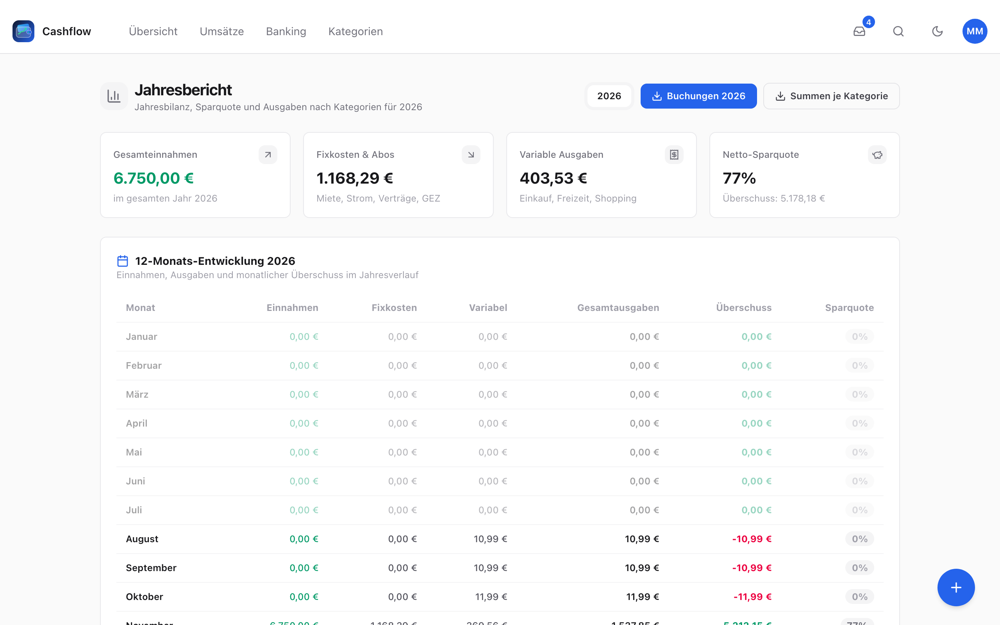
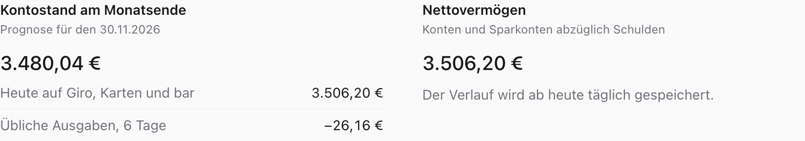
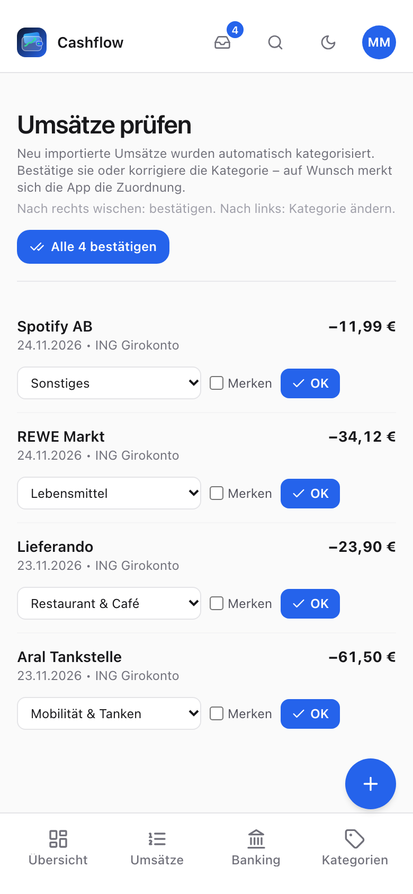
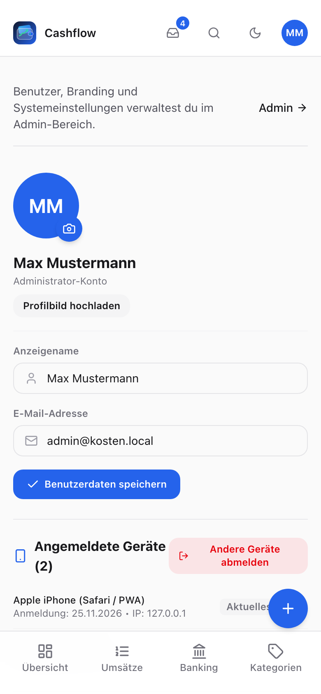
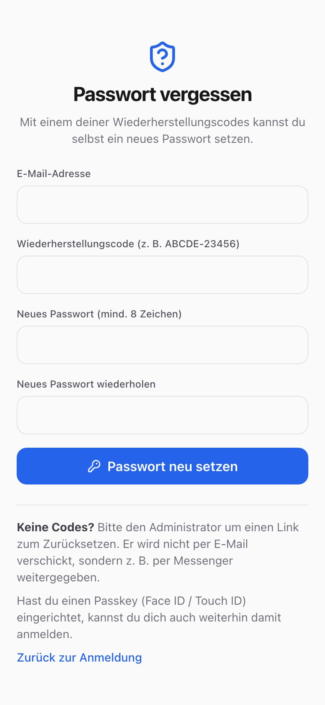
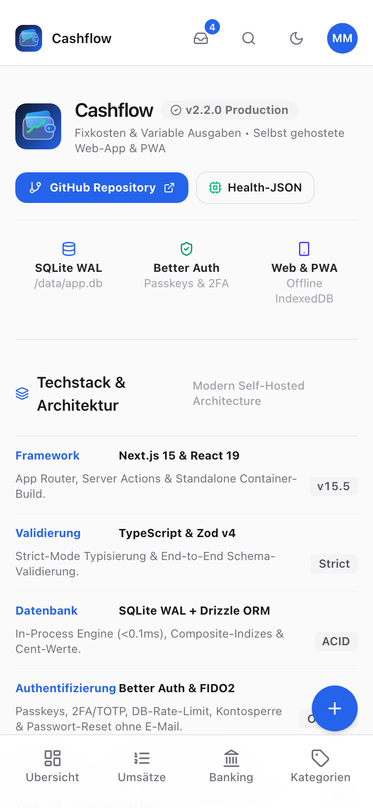

<div align="center">


# Cashflow

Selbst gehostete Web-App (PWA) für Fixkosten, Einnahmen, Ausgaben und Konten.

[](https://github.com/MHabachia/cashflow/actions/workflows/ci.yml)
[](https://github.com/MHabachia/cashflow/releases/latest)
[](https://github.com/MHabachia/cashflow/pkgs/container/cashflow)
[](LICENSE)

</div>

---

## Funktionen

**Erfassen**
- Schnellerfassung mit Vorlagen, Datum-Schnellwahl und Kontoauswahl; Belegfotos (Kamera oder Upload).
- Split-Buchungen auf mehrere Kategorien, Haupt- und Unterkategorien.
- Offline erfassen (PWA); die Einträge werden bei der nächsten Verbindung übertragen.
- Import von CSV, CAMT.053 und PDF-Kontoauszügen.

**Konten und Banken**
- Bankanbindung über PSD2 (ING, Sparkasse, C24, Commerzbank u. a.), nur lesend.
- Manuelle Konten, Kreditkarten und Bargeld, mit Salden und Umbuchungen.
- Umbuchungen zwischen eigenen Konten werden erkannt und zählen nicht als Ausgabe.
- Manuelle Kreditkarten lassen sich mit dem Girokonto verknüpfen: Der Kartenausgleich passt den Kartensaldo automatisch an.
- Umsätze prüfen: neue Buchungen landen zuerst in einer Prüfliste.

**Planung und Auswertung**
- Fixkosten und Einnahmen mit Intervall, Fixkosten-Kalender und Erkennung von Abos.
- Monatsbudgets mit Warnung bei 80 % und 100 %, Sparziele mit Zeitplan.
- Dashboard mit Prognose zum Monatsende, Nettovermögen und Monatsabschluss.
- Jahresbericht und CSV-Export (Buchungen oder Summen je Kategorie).
- Regeln, die Buchungen automatisch kategorisieren.

**Konto und Betrieb**
- Passkeys, Zwei-Faktor-Anmeldung, Passwort-Wiederherstellung ohne E-Mail.
- Registrierung nur per Einladung; Admin-Bereich mit Benutzern, Branding und Sicherheitsprotokoll.
- Automatische, optional verschlüsselte Sicherungen mit Prüffunktion; Systemzustand im Admin-Bereich.
- Push-Benachrichtigungen, Hell- und Dunkelmodus, Suche mit Tastenkürzel (Strg/Cmd + K).

---

## Screenshots

<div align="center">
  
  <br /><br />
  
  <br /><br />
  
  <br /><br />
  
  
  
  <br /><br />
  
  
  
  <br /><br />
  
  
  
</div>

---

## Schnellstart

```bash
mkdir cashflow && cd cashflow
curl -O https://raw.githubusercontent.com/MHabachia/cashflow/main/docker-compose.yml
echo "APP_URL=https://cashflow.example.org" > .env
docker compose up -d
```

Danach `/register` öffnen und das erste Konto anlegen, es wird Admin. Ohne `AUTH_SECRET` in der `.env` erzeugt der Container beim ersten Start selbst eines. Der Port ist standardmäßig nur lokal (`127.0.0.1:3000`) für einen Reverse Proxy erreichbar.

Ausführlich, mit empfohlenen Schlüsseln (`TOKEN_ENCRYPTION_KEY`, `BACKUP_ENCRYPTION_KEY`, `CRON_SECRET`), Reverse Proxy, Cloudflare Tunnel und Aktualisieren: **[Installation und Betrieb](docs/deployment.md)**.

## Dokumentation

| Thema | Inhalt |
|---|---|
| [Installation und Betrieb](docs/deployment.md) | Docker Compose, Reverse Proxy, Cloudflare Tunnel, Härtung, Aktualisieren, PWA |
| [Konfiguration](docs/configuration.md) | Alle Umgebungsvariablen |
| [Bankanbindung](docs/banking.md) | Unterstützte Banken, Einrichtung |
| [Sicherung](docs/backup.md) | Automatische und manuelle Sicherung, Wiederherstellung |
| [Sicherheit](docs/security.md) | Schutzmaßnahmen, bekannte Einschränkungen, Passwort vergessen |
| [Changelog](CHANGELOG.md) | Änderungen je Version |

---

## Weitere Funktionen im Detail

- **Umsätze prüfen (`/inbox`):** Umsätze aus Bank-Sync und Import landen zur Bestätigung in einer Prüfliste. Kategorie korrigieren, bestätigen und auf Wunsch eine Regel für den Händler anlegen. Am Handy bestätigt Wischen nach rechts, nach links öffnet die Kategorie.
- **Abo-Erkennung:** Auf der Fixkosten-Seite schlägt die App regelmäßige Abbuchungen als Fixkosten vor und meldet Preiserhöhungen.
- **Prognose und Nettovermögen:** Voraussichtlicher Kontostand zum Monatsende (aktueller Stand, minus anstehende Fixkosten, minus durchschnittliche variable Ausgaben der letzten 90 Tage) und täglich gespeicherter Vermögensverlauf.
- **Fixkosten-Kalender:** Fälligkeiten des Monats; die App warnt, wenn der Kontostand dafür rechnerisch nicht reicht.
- **Monatsabschluss:** In den ersten zehn Tagen des Monats zeigt das Dashboard einen Rückblick auf den Vormonat.
- **CAMT.053-Import:** XML-Kontoauszüge (camt.052/053/054) werden beim Import erkannt; das Konto wird über die IBAN zugeordnet.
- **Push-Benachrichtigungen:** Pro Gerät aktivierbar (iOS ab 16.4 nur als installierte App): Budgets, ablaufender Bankzugriff, hohe Abbuchungen, offene Umsätze.
- **Admin-Bereich:** Benutzer, Rollen, Einladungen (1, 7 oder 30 Tage gültig), Branding mit Vorschau und Kontrastprüfung, Systemzustand, Sicherungen (mit „Prüfen"), Sicherheitsprotokoll mit Filter.
- **Update-Hinweis:** Der Admin-Bereich fragt höchstens alle 6 Stunden das neueste GitHub-Release ab. Es werden keine Nutzerdaten gesendet. Abschalten mit `UPDATE_CHECK=false`.

---

## Entwicklung

Voraussetzung: Node.js 22 (siehe `.nvmrc`).

```bash
npm install
npm run db:migrate
npm run db:seed
npm run dev
```

- Typprüfung: `npm run typecheck`
- Unit-Tests: `npm run test:unit`
- UI-Tests (Playwright): `npm run test:e2e`
- Screenshots neu erzeugen: `npm run build`, danach `npx tsx scripts/take-screenshots.ts`

Das Seed-Skript legt ein **Demo-Konto nur für die lokale Entwicklung** an (`admin@kosten.local` / `AdminPassword123!`). Mit `NODE_ENV=production` verweigert es den Start.

**Datenbank-Migrationen:** Schemaänderungen laufen über versionierte Migrationen in `src/lib/db/migrations.ts`. Jede Migration läuft beim Start genau einmal und wird in `schema_migrations` vermerkt. Bestehende Migrationen werden nie geändert; neue kommen ans Ende. `drizzle-kit push` nicht verwenden.

**Overrides in `package.json`:** `drizzle-kit` bringt über `@esbuild-kit` eine ältere `esbuild`-Version mit einer bekannten Schwachstelle im Entwicklungsserver mit; der Override hebt `esbuild` auf mindestens 0.25. Next.js 15 bündelt PostCSS 8.4.31 mit bekannten Schwachstellen; der Override hebt es auf 8.5. Beide Overrides entfernen, sobald `drizzle-kit` bzw. Next.js die Versionen selbst mitbringen (`npm audit` prüft das in der CI).

## Lizenz

MIT, siehe [LICENSE](LICENSE).
